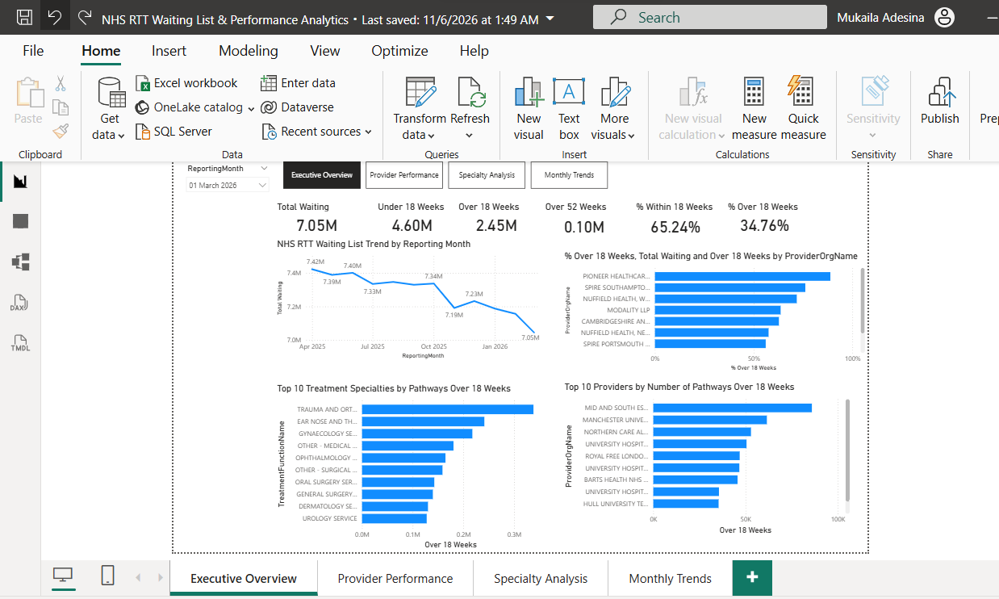
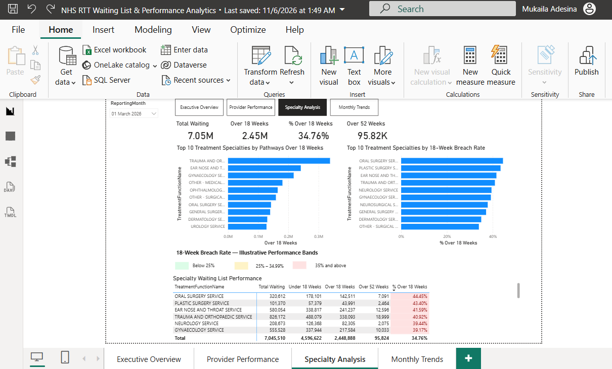
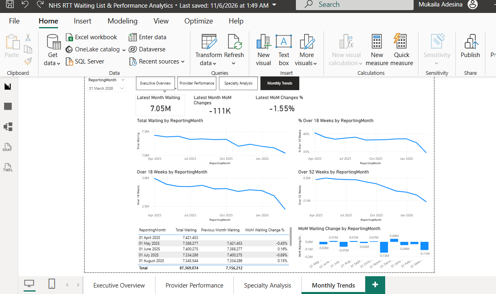

## Power BI Dashboard — Analytical Insights

The Power BI reporting solution consists of four interactive dashboards designed to monitor NHS Referral to Treatment (RTT) waiting-list performance, identify long-wait pressures, compare provider performance and support evidence-based healthcare planning.

The following analysis is based on the March 2026 reporting period, using the published NHS RTT data processed through the SSIS ETL pipeline and SQL Server data warehouse.

---

### Dashboard 1: Executive Overview

**Purpose:** Provide a high-level overview of NHS waiting-list volumes, 18-week performance, long waits, monthly trends and provider-level pressures.

#### 1. Executive KPI Analysis

| KPI | March 2026 |
|---|---:|
| Total Waiting | 7.05 million |
| Under 18 Weeks | 4.60 million |
| Over 18 Weeks | 2.45 million |
| Over 52 Weeks | 0.10 million |
| % Within 18 Weeks | 65.24% |
| % Over 18 Weeks | 34.76% |

**Key Findings:**

- Approximately 7.05 million incomplete RTT pathways were recorded for March 2026.
- Around 4.60 million pathways were within 18 weeks, representing 65.24% of the total.
- Approximately 2.45 million pathways exceeded 18 weeks, equivalent to 34.76%.
- Approximately 100,000 pathways had exceeded 52 weeks, indicating a continuing long-wait challenge.

**Business Insight:**

More than one-third of incomplete RTT pathways have exceeded 18 weeks. This indicates significant waiting-list pressure and highlights the importance of monitoring both overall waiting-list volumes and the distribution of waiting times.

The 52-week indicator provides an additional measure of prolonged waiting, helping decision-makers distinguish general backlog pressures from particularly long waits.

#### 2. NHS RTT Waiting List Trend by Reporting Month

**Key Findings:**

- The waiting-list trend shows an overall decline from approximately 7.42 million in April 2025 to 7.05 million in March 2026.
- This represents an approximate reduction of 370,000 pathways, or 5.0%.
- The decline was not consistent across every month, with periods of relative stability and temporary increases.
- The most recent months show a downward movement in total waiting-list volume.

**Business Insight:**

The overall decline suggests an improvement in the number of incomplete pathways awaiting treatment across the reporting period.

However, a reduction in total waiting-list volume does not necessarily mean that waiting-time performance has improved proportionately.

Further analysis should compare changes in total waiting-list volume against changes in the number and percentage of pathways exceeding 18 and 52 weeks.

#### 3. Providers by Percentage Over 18 Weeks

**Key Findings:**

- The chart reveals substantial variation in the percentage of pathways exceeding 18 weeks across providers.
- Pioneer Healthcare appears among the providers with the highest breach percentages.
- Several specialist and independent providers also display relatively high proportions of long-wait pathways.
- High breach percentages do not necessarily correspond to the largest waiting-list volumes.

**Business Insight:**

Provider-level breach rates help identify organisations with relatively high concentrations of overdue pathways.

However, provider size, specialty mix and patient complexity should be considered before interpreting these differences as evidence of operational underperformance.

#### 4. Top 10 Treatment Specialties by Pathways Over 18 Weeks

**Key Findings:**

- Trauma and Orthopaedics records the highest overdue pathway volume among the specialties displayed.
- Ear, Nose and Throat and Gynaecology also contribute substantial numbers of pathways exceeding 18 weeks.
- Other specialties, including Ophthalmology, General Surgery and Urology, contribute to the overall backlog.
- Overdue pathways are distributed unevenly across treatment specialties.

**Business Insight:**

The concentration of overdue pathways within particular specialties suggests that backlog-reduction strategies may benefit from specialty-specific planning.

For example, reviewing theatre capacity, outpatient demand, diagnostic availability and referral-to-treatment processes may help identify potential constraints.

The dashboard does not establish which of these factors is responsible for the observed waiting times.

#### 5. Top 10 Providers by Number of Pathways Over 18 Weeks

**Key Findings:**

- Mid and South Essex NHS Foundation Trust has the highest overdue pathway volume among the providers displayed.
- Manchester University NHS Foundation Trust and Northern Care Alliance NHS Foundation Trust also contribute substantial overdue volumes.
- Large providers can contribute significant numbers of overdue pathways even when their breach percentages are below those of smaller providers.

**Business Insight:**

Absolute overdue pathway volumes help identify where backlog-reduction activity could have the greatest numerical impact.

Provider comparisons should therefore combine absolute overdue volumes with breach rates rather than relying exclusively on one measure.

#### Management Recommendations

1. Monitor both total waiting-list volumes and 18-week performance to assess whether backlog reductions translate into shorter waits.
2. Prioritise investigation of specialties contributing the greatest overdue pathway volumes.
3. Use provider-level comparisons to identify organisations requiring further operational review.
4. Track pathways exceeding 52 weeks separately to monitor prolonged waits.
5. Introduce month-on-month and year-on-year performance indicators to identify sustained improvements or deterioration.

#### Analytical Conclusion

The Executive Overview dashboard indicates that NHS RTT waiting-list volumes declined between April 2025 and March 2026.

Despite this reduction, approximately 34.76% of incomplete pathways remained above 18 weeks in March 2026.

The analysis highlights the importance of combining national waiting-list trends with provider and specialty performance indicators to support targeted investigation and evidence-based planning.

---

### Dashboard 2: Provider Performance

**Purpose:** Compare NHS providers using overdue pathway volumes, 18-week breach percentages and detailed waiting-list performance measures.

#### 1. Top 10 Providers by Overdue Pathway Volume

**Key Findings:**

- Mid and South Essex NHS Foundation Trust recorded 85,939 pathways exceeding 18 weeks, the highest among the providers displayed.
- Manchester University NHS Foundation Trust recorded 61,550 overdue pathways.
- Northern Care Alliance NHS Foundation Trust recorded 52,942 overdue pathways.
- University Hospitals Sussex NHS Foundation Trust recorded 50,526 overdue pathways.

**Business Insight:**

The distribution of overdue pathways demonstrates that some providers contribute substantially more to the absolute backlog than others.

These organisations represent useful starting points for further investigation because reductions in their overdue pathway volumes could have a meaningful impact on overall waiting-list totals.

However, absolute volumes must be interpreted alongside provider size and the complexity of services delivered.

#### 2. Top 10 Providers by 18-Week Breach Rate

**Key Findings:**

- Pioneer Healthcare appears to record the highest breach percentage in the displayed chart, at approximately 90%.
- Several specialist providers also show relatively high breach percentages.
- Providers with the highest breach rates are not necessarily those with the largest absolute numbers of overdue pathways.
- This demonstrates the importance of distinguishing relative performance from total backlog size.

**Business Insight:**

The 18-week breach rate measures the proportion of incomplete pathways that have exceeded 18 weeks.

A smaller provider may report a high breach percentage despite having relatively few overdue pathways.

Conversely, a large provider may have a lower breach percentage but contribute significantly more pathways to the overall backlog.

Both indicators are therefore necessary for balanced performance evaluation.

#### 3. Provider Waiting List Performance — Detailed Analysis

The table provides a more detailed comparison of selected NHS providers.

| Provider | Total Waiting | Over 18 Weeks | % Over 18 Weeks |
|---|---:|---:|---:|
| Manchester University NHS FT | 166,330 | 61,550 | 37.00% |
| Mid and South Essex NHS FT | 173,977 | 85,939 | 49.40% |
| Royal Free London NHS FT | 133,390 | 46,821 | 35.10% |
| Northern Care Alliance NHS FT | 129,221 | 52,942 | 40.97% |
| Barts Health NHS Trust | 121,511 | 45,669 | 37.58% |
| University Hospitals of Leicester NHS Trust | 113,973 | 46,626 | 40.91% |
| University Hospitals Sussex NHS FT | 112,535 | 50,526 | 44.90% |

**Key Findings:**

- Mid and South Essex combines the highest overdue volume among the displayed providers with a relatively high breach rate of 49.40%.
- University Hospitals Sussex records a breach rate of 44.90%, indicating a substantial proportion of pathways exceeding 18 weeks.
- Manchester University has a larger total waiting list than Northern Care Alliance but a lower breach percentage.
- Royal Free London has a breach rate of 35.10%, lower than several other providers shown in the comparison.

**Business Insight:**

The findings demonstrate that waiting-list size alone is insufficient to evaluate provider performance.

A meaningful comparison requires consideration of:

- Total incomplete pathways.
- Number of pathways exceeding 18 weeks.
- Percentage of pathways exceeding 18 weeks.
- Number of pathways exceeding 52 weeks.
- Provider service mix and operational context.

Combining these measures helps distinguish providers with large absolute backlogs from those experiencing higher relative waiting-time pressures.

#### 4. National Performance Context

The dashboard's total row provides the following March 2026 context:

| KPI | Value |
|---|---:|
| Total Waiting | 7,045,510 |
| Under 18 Weeks | 4,596,622 |
| Over 18 Weeks | 2,448,888 |
| Over 52 Weeks | 95,824 |
| % Over 18 Weeks | 34.76% |

**Key Findings:**

- Mid and South Essex's breach rate of 49.40% is approximately 14.64 percentage points above the overall rate of 34.76%.
- University Hospitals Sussex's breach rate of 44.90% is approximately 10.14 percentage points above the overall rate.
- Northern Care Alliance's breach rate of 40.97% is approximately 6.21 percentage points above the overall rate.

**Business Insight:**

Comparing provider breach percentages with the overall rate helps identify organisations reporting above-average concentrations of overdue pathways.

However, this is a descriptive comparison rather than a risk-adjusted performance assessment.

Further investigation should consider specialty composition, provider size and changes over time.

#### Management Recommendations

1. Prioritise further investigation of providers combining high overdue pathway volumes with high breach rates.
2. Compare providers with similar specialty portfolios to improve the fairness of performance benchmarking.
3. Introduce month-on-month provider performance measures to identify improving and deteriorating trends.
4. Monitor 52-week waits alongside 18-week breaches to identify prolonged waiting-time pressures.
5. Develop provider-level drill-through reports to investigate which treatment specialties contribute most to overdue volumes.

#### Analytical Conclusion

The Provider Performance dashboard reveals substantial variation in waiting-list pressures across NHS providers.

Mid and South Essex NHS Foundation Trust demonstrates both a high absolute overdue pathway volume and a relatively high 18-week breach rate.

Other providers exhibit different performance profiles, reinforcing the need to assess waiting-list volume and breach percentage together.

The central analytical finding is that effective provider prioritisation requires a combination of absolute backlog size, relative waiting-time performance and service context rather than reliance on a single KPI.

---

### Analytical Scope and Limitations

- The analysis uses aggregated NHS RTT pathway data rather than individual patient-level records.
- The findings describe observed patterns and do not establish the causes of waiting-list delays.
- Provider comparisons are not adjusted for case mix, specialty complexity or organisational size.
- The March 2026 findings reflect the dashboard's reporting-period selection.
- Waiting-list measures should be calculated consistently using the appropriate incomplete-pathway records to avoid double counting.
- Further longitudinal analysis is required before attributing improvements or deterioration to specific operational interventions.

## 3. Specialty Analysis

**Reporting period:** March 2026  
**Purpose:** Identify which treatment specialties contribute most to overdue RTT pathways, compare relative 18-week breach rates, and examine waits exceeding 52 weeks.

### 3.1 Specialty KPI overview

| Measure | March 2026 |
|---|---:|
| Total incomplete pathways | 7,045,510 |
| Pathways over 18 weeks | 2,448,888 |
| 18-week breach rate | 34.76% |
| Pathways over 52 weeks | 95,824 |

**Key findings:** Approximately one in three incomplete pathways exceeded 18 weeks. The 52-week measure identifies a smaller but important subset experiencing prolonged waits. These are *pathway counts*, not distinct patient counts.

### 3.2 Top 10 specialties by overdue pathway volume

**Key findings:** Trauma and Orthopaedics leads the displayed specialties, followed by Ear, Nose and Throat (ENT) and Gynaecology. The bars show absolute counts rather than percentages.

**Key findings:**

- **Trauma and Orthopaedics:** 338,093 pathways over 18 weeks, approximately **13.81%** of the national overdue total.
- **ENT:** 241,237 overdue pathways, approximately **9.85%** of the national overdue total.
- **Gynaecology:** 217,584 overdue pathways, approximately **8.88%** of the national overdue total.
- Together, these three specialties account for **796,914 overdue pathways**, approximately **32.54%** of the overall overdue total.

**Business insight:** Concentration of overdue pathways suggests that these specialties are high-value starting points for investigating backlog reduction. It does **not** prove that the specialties have the worst operational performance; high volume may partly reflect larger overall caseloads.

**Management action:** Investigate the trend and composition of overdue pathways within these specialties, including provider variation and the proportion waiting over 52 weeks.

### 3.3 Top 10 specialties by 18-week breach rate

**Key findings:** Oral Surgery and Plastic Surgery have the highest displayed breach percentages, even though they do not have the largest overdue volumes.

| Specialty | Total waiting | Over 18 weeks | Over 52 weeks | Breach rate | Difference from overall rate |
|---|---:|---:|---:|---:|---:|
| Oral Surgery | 320,612 | 142,511 | 7,091 | 44.45% | +9.69 pp |
| Plastic Surgery | 101,370 | 43,991 | 2,464 | 43.40% | +8.64 pp |
| ENT | 580,054 | 241,237 | 12,596 | 41.59% | +6.83 pp |
| Trauma and Orthopaedics | 826,172 | 338,093 | 18,999 | 40.92% | +6.16 pp |
| Neurology | 208,673 | 82,305 | 2,075 | 39.44% | +4.68 pp |
| Gynaecology | 555,528 | 217,584 | 10,033 | 39.17% | +4.41 pp |

*pp = percentage points. Values are transcribed from the displayed dashboard table; verify against the underlying model before external publication.*

**Business insight:** The rankings change depending on whether performance is assessed by **absolute overdue volume** or **relative breach rate**. Oral Surgery has the highest displayed rate (44.45%), whereas Trauma and Orthopaedics has the largest overdue volume (338,093). Both views are needed to prioritise investigation fairly.

**Management action:** Use a two-axis assessment—overdue pathway count and breach rate—before selecting specialties for detailed review. Compare like-for-like services where possible.

### 3.4 Long waits over 52 weeks

**Key findings:**

- Trauma and Orthopaedics: **18,999** pathways over 52 weeks.
- ENT: **12,596** pathways over 52 weeks.
- Gynaecology: **10,033** pathways over 52 weeks.
- Together, these account for **41,628**, or approximately **43.44%** of the national 52-week total of 95,824.

**Business insight:** The 52-week distribution provides a distinct perspective from the 18-week breach rate: it helps identify where the longest recorded waits are concentrated.

**Management action:** Add a measure for **52-week waits as a percentage of each specialty's total waiting list**, alongside its absolute count, to separate scale from severity.

### Specialty Analysis — analytical conclusion

The specialty dashboard reveals two different forms of pressure: **large overdue backlogs** in Trauma and Orthopaedics, ENT and Gynaecology, and **high relative breach rates** in Oral and Plastic Surgery. A balanced prioritisation strategy should consider both measures, together with 52-week waits and changes over time. The charts do not establish whether capacity, demand, diagnostics, workforce or case mix causes these differences.

---

## 4. Monthly Trends

**Reporting window shown:** April 2025–March 2026  
**Purpose:** Assess whether the waiting list and long-wait measures are improving over time, quantify month-on-month changes, and identify potential turning points.

### 4.1 Latest-month KPI cards

| Measure | March 2026 |
|---|---:|
| Latest month waiting | 7.05 million |
| Latest month-on-month change | -111,000 approximately |
| Latest month-on-month change % | -1.55% |

**Key findings:** The March 2026 waiting list was approximately **111,000 pathways lower** than February 2026, a **1.55% month-on-month decline**. This is a change in the recorded stock of incomplete pathways, not a direct measure of treatments completed.

### 4.2 Total waiting by reporting month

**Key findings:** The total waiting list generally trends downward across April 2025–March 2026, with intermittent stabilisation and small rebounds.

**Key findings:**

- The monthly table shows **7,421,453** pathways in April 2025.
- March 2026 shows **7,045,510** pathways.
- The net change is **-375,943 pathways**, approximately **-5.07%** relative to April 2025.
- A visible sharper decline occurs around November 2025, with further reductions near the end of the reporting window.

**Business insight:** The downward trend is encouraging as a descriptive measure of backlog size. However, a smaller waiting list can arise from several mechanisms, including changes in referrals, completed pathways, validation, and reporting practices. The chart does not isolate the cause.

**Management action:** Compare monthly waiting-list stock with referral inflows, completed pathways and data-quality adjustments where those datasets are available.

### 4.3 Percentage over 18 weeks by reporting month

**Key findings:** The breach percentage falls from roughly 40% near April 2025 to **34.76%** in March 2026, with periods of relative stability and a more pronounced fall at the end.

**Business insight:** This suggests that the share of incomplete pathways above 18 weeks declined over the period. Because the chart uses percentages, it should be interpreted alongside the absolute overdue count; otherwise, denominator changes may obscure what happened to the number of overdue pathways.

**Management action:** Present the 18-week breach **percentage and absolute count together** and calculate the month-on-month percentage-point change.

### 4.4 Pathways over 18 weeks by reporting month

**Key findings:** The count of overdue pathways decreases from approximately **3.0 million** at the beginning of the displayed period to **2,448,888** in March 2026.

**Business insight:** The decline in both overdue counts and the breach rate is more informative than a falling total waiting list alone: it indicates that the over-18-week portion of the recorded backlog also contracted. The precise month-by-month changes should be calculated from the underlying table, not estimated from the plotted line.

**Management action:** Create a month-on-month overdue-count measure and flag months where the overall list falls but overdue pathways rise.

### 4.5 Pathways over 52 weeks by reporting month

**Key findings:** The over-52-week series falls from roughly **0.19–0.20 million** early in the period to **95,824** in March 2026.

**Business insight:** The decline suggests improvement in the volume of the longest waits shown in the dashboard. It does not establish whether those pathways were treated, removed through validation or otherwise left the incomplete-pathway stock.

**Management action:** Track 52-week counts and rates over time, ideally alongside longer-wait bands and specialty/provider drill-through.

### 4.6 Month-on-month waiting-list change

**Key findings:** The column chart shows both increases and decreases in monthly waiting-list volume. The largest visible negative monthly change occurs around November 2025, while March 2026 also shows a substantial reduction.

**Examples visible in the monthly table:**

| Reporting month | Total waiting | MoM waiting change % |
|---|---:|---:|
| April 2025 | 7,421,453 | Baseline / not displayed |
| May 2025 | 7,388,277 | -0.45% |
| June 2025 | 7,400,275 | +0.16% |
| July 2025 | 7,334,286 | -0.89% |
| August 2025 | 7,345,544 | +0.15% |
| March 2026 | 7,045,510 | -1.55% |

**Business insight:** A single month's reduction should not be interpreted as a sustained improvement. The presence of increases in June and August shows why trend analysis is more reliable than focusing only on the latest KPI.

**Management action:** Add three-month rolling averages, month-on-month absolute and percentage changes, and indicators for consecutive months of improvement.

### Monthly Trends — analytical conclusion

Across the displayed reporting window, the total incomplete RTT waiting list declines by approximately **375,943 pathways (5.07%)**. The dashboard also shows declines in the **number and proportion** of pathways over 18 weeks and in the number over 52 weeks. These movements are consistent with improving recorded waiting-list indicators, but the report does not demonstrate which operational actions produced them. The next analytical step is to investigate changes by provider and specialty and, where possible, triangulate with activity and referral data.

---

## 5. Cross-Dashboard Interpretation and Limitations

- **Volume and rate answer different questions:** Absolute overdue pathways identify the largest contributions to the backlog; breach percentages identify concentrations of longer waits.
- **Do not infer causation:** Changes may reflect activity, demand, validation or reporting changes; the dashboard does not separate these factors.
- **RTT pathways are not unique patients:** Avoid describing counts as numbers of individual patients.
- **Use consistent populations:** Incomplete-pathway metrics must not double-count overlapping RTT part types.
- **Check exact values:** Rounded cards and visually estimated chart values should be reconciled to the SQL warehouse and DAX measures before publication.
- **Interpret comparisons cautiously:** Specialty and provider comparisons are not adjusted for case mix, service configuration or organisational scale.

